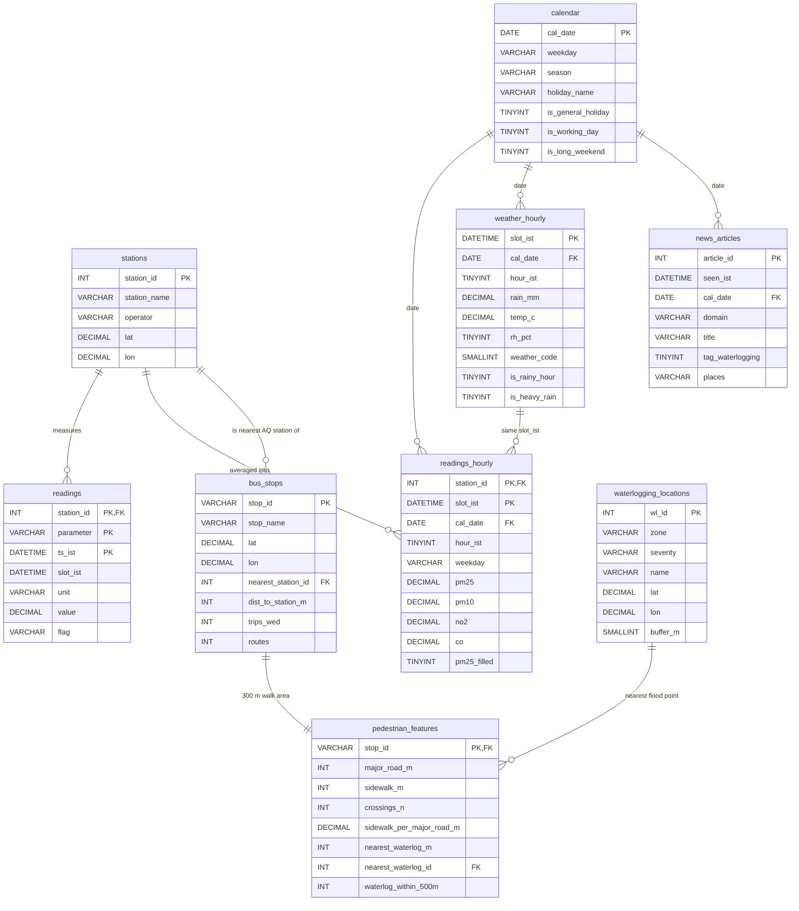

# ER diagram

Nine tables, defined in [`sql/schema.sql`](../sql/schema.sql). GitHub renders the diagram below;
a PNG copy is in [`docs/er_diagram.png`](er_diagram.png) for the report.

## How the keys work

| Relationship | Key | Note |
|---|---|---|
| stations -> readings / readings_hourly | `station_id` (OpenAQ location id) | the text name carries a changing suffix, so it is never used as a key |
| readings_hourly <-> weather_hourly | `slot_ist` | both sources are mapped to the same hourly slot (17:30-18:30 IST = slot 18:00). Not a declared FK because weather is city-wide, but it is the main join |
| readings_hourly / weather_hourly / news_articles -> calendar | `cal_date` | IST date, so a UTC 22:00 news item lands on the next Bengaluru day |
| stations -> bus_stops | `nearest_station_id` | computed by distance (stops within 1.5 km) |
| bus_stops -> pedestrian_features | `stop_id` (1:1) | metrics of what OSM shows within 300 m |
| waterlogging_locations -> pedestrian_features | `nearest_waterlog_id` | computed by distance |
